# 01 — Data Model & ER Design

## 1. Modelling decisions taken

| Decision | Choice | Rationale |
|---|---|---|
| D1 | **Separate `quotations` and `invoices` tables** (not one polymorphic `documents` table) | PRD §51/§52 defines them separately; they genuinely differ (expiry vs due date + payment terms, different status machines, different numbering series). Duplication is avoided in the **service and UI layers**, not by collapsing schemas. |
| D2 | **Line-level tax rows** (`quotation_item_taxes`, `invoice_item_taxes`) | CGST + SGST on one line means one line has *n* tax components. A single `tax_rate` column cannot express that, and the PDF needs a per-component breakdown. |
| D3 | **Tax summary also stored as JSON** on the document | The PDF's tax summary block must be reproducible byte-for-byte years later even if tax masters change. Derivable data is cached deliberately, as a snapshot. |
| D4 | **Address, customer, item, tax and company data is snapshotted onto documents** | Editing a customer's address in 2027 must not silently rewrite a 2026 invoice. Masters are for *authoring*; documents store what was printed. |
| D5 | **`customer_addresses` table + snapshot columns on documents** | PRD §51 lists the table, §52 lists inline fields. Both are right for their purpose: master = normalised, document = frozen copy. |
| D6 | **No hard deletes on financial data** | `status` + `archivedAt` + `deletedAt` (drafts only). Retention is permanent per PRD §41. |
| D7 | **`document_sequences` table** (not in the PRD list) | Needed for concurrency-safe, per-FY, per-type numbering with a row lock. |
| D8 | **`document_files` covers both uploads and generated PDFs** | One storage abstraction, discriminated by `kind`; each generated PDF is tied to a document **version**. |
| D9 | **`document_shares` + `email_messages`** (not in the PRD list) | Required to implement "copy secure link", the `VIEWED` status, and a send history/audit trail. |
| D10 | **`invoice_payments` proposed but flag-gated** | Needed for `PAID`/`PARTIALLY_PAID`/`OVERDUE` KPIs and customer "Outstanding Amount". Manual entry only — not a gateway. **Needs approval** (see `10-open-questions.md`, Q2). |
| D11 | **Permission-based RBAC** with `roles`, `permissions`, `role_permissions` | PRD §51 lists these tables; code checks *permissions*, roles are just bundles. Lets the Admin/Super-Admin split be tuned without redeploying. |
| D12 | **Money as `DECIMAL(18,4)`, quantity `DECIMAL(18,3)`, percentages `DECIMAL(9,4)`** | 4 dp of headroom for intermediate values across currencies; presented and rounded to each currency's own decimal places. |

## 2. ER diagram

```mermaid
erDiagram
  roles ||--o{ users : has
  roles ||--o{ role_permissions : grants
  permissions ||--o{ role_permissions : in
  users ||--o{ refresh_tokens : owns
  users ||--o{ audit_logs : performs

  company_settings ||--o{ company_bank_accounts : has

  financial_years ||--o{ quotations : scopes
  financial_years ||--o{ invoices : scopes
  financial_years ||--o{ document_sequences : scopes
  numbering_series ||--o{ document_sequences : configures

  currencies ||--o{ customers : default_for
  currencies ||--o{ items : priced_in
  currencies ||--o{ quotations : denominates
  currencies ||--o{ invoices : denominates

  tax_types ||--o{ tax_rates : defines
  tax_rates ||--o{ items : default_tax
  tax_rates ||--o{ quotation_item_taxes : applied_as
  tax_rates ||--o{ invoice_item_taxes : applied_as

  units ||--o{ items : measured_in
  item_categories ||--o{ items : groups

  customers ||--o{ customer_addresses : has
  customers ||--o{ customer_contacts : has
  customers ||--o{ quotations : receives
  customers ||--o{ invoices : receives

  items ||--o{ quotation_items : referenced_by
  items ||--o{ invoice_items : referenced_by

  templates ||--o{ template_versions : versions
  template_versions ||--o{ quotations : rendered_with
  template_versions ||--o{ invoices : rendered_with

  quotations ||--o{ quotation_items : contains
  quotation_items ||--o{ quotation_item_taxes : taxed_by
  quotations ||--o{ quotation_revisions : history
  quotations ||--o| invoices : converted_to

  invoices ||--o{ invoice_items : contains
  invoice_items ||--o{ invoice_item_taxes : taxed_by
  invoices ||--o{ invoice_revisions : history
  invoices ||--o{ invoice_payments : settled_by

  quotations ||--o{ document_files : attachments_and_pdfs
  invoices ||--o{ document_files : attachments_and_pdfs
  quotations ||--o{ document_shares : shared_via
  invoices ||--o{ document_shares : shared_via
  quotations ||--o{ email_messages : sent_as
  invoices ||--o{ email_messages : sent_as
```



## 3. Entity catalogue

### 3.1 Identity & access

| Table | Purpose | Key columns |
|---|---|---|
| `users` | Application users | `id`, `name`, `email` (unique), `passwordHash`, `roleId`, `status` (ACTIVE/INACTIVE/LOCKED), `lastLoginAt`, `failedLoginCount`, `lockedUntil` |
| `roles` | `SUPER_ADMIN`, `ADMIN`, `FINANCE_VIEWER` | `id`, `key` (unique), `name`, `description`, `isSystem` |
| `permissions` | Atomic capability, e.g. `invoice.create` | `id`, `key` (unique), `module`, `action`, `description` |
| `role_permissions` | Join | `roleId`, `permissionId` (composite PK) |
| `refresh_tokens` | Rotating refresh tokens | `id`, `userId`, `tokenHash`, `expiresAt`, `revokedAt`, `replacedById`, `ip`, `userAgent` |

### 3.2 Company & configuration

| Table | Purpose | Notes |
|---|---|---|
| `company_settings` | Singleton (`id = 1`) | Legal/trade name, full address, state + **stateCode** (needed for GST place-of-supply), phone, email, website, GSTIN, PAN, CIN, `logoFileId`, `faviconFileId`, `signatureFileId`, `primaryColor`, `secondaryColor`, `defaultFont`, `baseCurrencyCode`, `defaultTemplateInvoiceId`, `defaultTemplateQuotationId`, `financialYearStartMonth` (default 4) |
| `company_bank_accounts` | 1..n bank accounts, one default | Bank name, account name/number, IFSC, SWIFT, branch, `paymentInstructions`, `currencyCode?`, `isDefault`, `status`. Selectable per document — a USD invoice can print a different account than an INR one |
| `app_settings` | Key/value for evolving config | `key`, `valueJson`, `updatedBy` — e.g. rounding mode, discount policy, share-link TTL |
| `financial_years` | FY master | `code` ("2026-27"), `startDate`, `endDate`, `isCurrent`, `status` (OPEN/CLOSED) |
| `numbering_series` | Configurable format per document type | `docType` (QUOTATION/INVOICE/CREDIT_NOTE-reserved), `prefix`, `pattern` (`"{PREFIX}-{FY_START}-{SEQ:4}"`), `padding`, `startNumber`, `resetPolicy` (FINANCIAL_YEAR/NEVER), `isActive` |
| `document_sequences` | Live counter, one row per (series, FY) | `numberingSeriesId`, `financialYearId`, `lastNumber` — unique together; incremented under `SELECT … FOR UPDATE` |
| `currencies` | Currency master (seed 10 per brief) | `code` (PK-ish unique, ISO-4217), `name`, `symbol`, `decimalPlaces`, `symbolPosition`, `thousandSeparatorStyle` (WESTERN/INDIAN), `isActive`, `sortOrder` |
| `exchange_rates` | Optional rate history for reporting | `fromCurrency`, `toCurrency`, `rate`, `effectiveDate`, `source` (MANUAL) |
| `tax_types` | CGST, SGST, IGST, UTGST, EXEMPT, ZERO_RATED, NON_GST | `key`, `name`, `scope` (INTRA_STATE/INTER_STATE/UT/NONE), `isCompound`, `isActive` |
| `tax_rates` | Configurable rates per type | `taxTypeId`, `name` ("CGST 9%"), `rate` DECIMAL(9,4), `effectiveFrom`, `effectiveTo`, `isActive` |
| `tax_groups` / `tax_group_rates` | Named bundles, e.g. "GST 18% (Intra)" = CGST 9 + SGST 9 | Lets a user pick one tax in the UI and get two components on the line |
| `units` | UOM master (NOS, HRS, DAY, MONTH, LOT, LICENSE…) | `code`, `name`, `isActive` |
| `item_categories` | Item grouping | `name`, `parentId?`, `status` |

### 3.3 Masters

| Table | Notes |
|---|---|
| `customers` | `customerCode` (unique, auto-generated + editable), `name`, `companyName`, `contactPerson`, `email`, `phone`, `altPhone`, `gstin`, `pan`, `otherTaxId`, `taxTreatment` (REGISTERED / UNREGISTERED / COMPOSITION / OVERSEAS / SEZ), `placeOfSupplyStateCode`, `defaultCurrencyCode`, `paymentTermsDays`, `notes`, `status` (ACTIVE/INACTIVE/ARCHIVED) |
| `customer_addresses` | `customerId`, `type` (BILLING/SHIPPING/OTHER), `label`, `line1`, `line2`, `city`, `state`, `stateCode`, `country`, `postalCode`, `isDefault` |
| `customer_contacts` | Optional extra contacts (name, designation, email, phone, `isPrimary`) — supports To/CC on send |
| `items` | `itemCode/SKU` (unique), `name`, `description`, `type` (PRODUCT/SERVICE), `unitId`, `defaultRate` DECIMAL(18,4), `currencyCode`, `defaultTaxRateId` or `defaultTaxGroupId`, `hsnSacCode`, `categoryId`, `status` |

### 3.4 Templates

| Table | Notes |
|---|---|
| `templates` | `key` ("corporate"/"modern"/"classic"), `name`, `docType` (INVOICE/QUOTATION/BOTH), `engineKey` (which renderer layout), `isDefault`, `status`, `createdBy` |
| `template_versions` | `templateId`, `version` (int, 1-based), `configJson` (validated by `TemplateConfigSchema`), `changeNote`, `status` (DRAFT/PUBLISHED/ARCHIVED), `publishedAt`, `createdBy`. **Immutable once PUBLISHED** — edits create version *n+1* |

Documents reference `templateVersionId` (not just `templateId`), which is what makes historical
documents re-render exactly as originally issued (PRD §28).

### 3.5 Documents

`quotations` and `invoices` share this column set (differences marked):

```text
id, number (unique per docType), financialYearId, customerId,
customerSnapshot        JSON   -- name, code, gstin, pan, contact, taxTreatment
billingAddressSnapshot  JSON
shippingAddressSnapshot JSON
companySnapshot         JSON   -- company + selected bank account as printed
placeOfSupplyStateCode
currencyCode, currencySymbol, currencyDecimalPlaces
exchangeRateToBase DECIMAL(18,8), baseCurrencyCode, baseTotal DECIMAL(18,4)
documentDate DATE
expiryDate DATE            -- QUOTATION only
dueDate DATE, paymentTermsDays  -- INVOICE only
referenceNumber, subject
status                     -- see 06-…#status-machines
subtotal, discountTotal, taxableTotal, taxTotal, adjustment, roundOff, grandTotal   (DECIMAL(18,4))
discountMode (NONE/PERCENT/AMOUNT), discountValue
taxSummaryJson JSON        -- frozen breakdown for the PDF
notes, terms, customerMessage, paymentInstructions
bankAccountId?, showBankDetails
templateId, templateVersionId
currentVersion INT         -- revision pointer, starts at 1
customFieldsJson JSON
quotationId?               -- INVOICE only: source quotation
convertedInvoiceId?        -- QUOTATION only: resulting invoice
sentAt, firstViewedAt, acceptedAt/paidAt, cancelledAt, cancelReason, archivedAt, deletedAt
createdBy, updatedBy, createdAt, updatedAt
```

`quotation_items` / `invoice_items`:

```text
id, documentId, lineNumber, itemId?, itemCode, name, description, hsnSacCode,
unitId?, unitCode, quantity DECIMAL(18,3), rate DECIMAL(18,4),
discountMode, discountValue DECIMAL(18,4), discountAmount DECIMAL(18,4),
lineGross, lineNet, allocatedDocDiscount, taxableAmount, taxAmount, lineTotal  (DECIMAL(18,4)),
taxGroupId?, isTaxExempt, exemptReason?, sortOrder
```

`quotation_item_taxes` / `invoice_item_taxes`:

```text
id, itemId(FK to line), taxRateId, taxTypeKey, label ("CGST 9%"),
ratePercent DECIMAL(9,4), taxableAmount DECIMAL(18,4), taxAmount DECIMAL(18,4)
```

`quotation_revisions` / `invoice_revisions`:

```text
id, documentId, version, changedBy, changeReason, previousDataJson, newDataJson,
diffSummaryJson, createdAt        -- append-only, never updated or deleted
```

`invoice_payments` *(flag-gated, pending approval)*:

```text
id, invoiceId, paymentDate, amount DECIMAL(18,4), currencyCode, exchangeRateToBase,
method (BANK_TRANSFER/CHEQUE/CASH/UPI/OTHER), reference, notes, recordedBy, createdAt
```

### 3.6 Files, sharing, audit

| Table | Notes |
|---|---|
| `document_files` | `entityType` (QUOTATION/INVOICE/COMPANY/TEMPLATE), `entityId`, `kind` (GENERATED_PDF / ATTACHMENT / LOGO / SIGNATURE / FAVICON / REPORT), `documentVersion?`, `storageKey`, `fileName`, `mimeType`, `sizeBytes`, `checksumSha256`, `templateVersionId?`, `createdBy`, `createdAt` |
| `document_shares` | `entityType`, `entityId`, `tokenHash`, `channel` (LINK/EMAIL/WHATSAPP), `expiresAt`, `revokedAt`, `viewCount`, `lastViewedAt`, `createdBy` |
| `email_messages` | Send log: `entityType`, `entityId`, `to[]`, `cc[]`, `subject`, `body`, `attachmentFileIds`, `status` (QUEUED/SENT/FAILED), `providerMessageId`, `error`, `sentBy`, `sentAt` |
| `audit_logs` | `userId?`, `userEmailSnapshot`, `action` (enum), `entityType`, `entityId`, `entityLabel`, `ip`, `userAgent`, `requestId`, `previousDataJson`, `newDataJson`, `metadataJson`, `createdAt`. **Append-only** — no update/delete path exists in the application |

## 4. Indexing plan (performance-relevant from day one)

- `invoices (financialYearId, status)`, `invoices (customerId, documentDate)`, `invoices (documentDate)`,
  `invoices (number)` unique, plus the same set on `quotations`.
- `invoices (status, dueDate)` — powers the overdue KPI.
- `quotation_items (documentId, sortOrder)`, `invoice_items (documentId, sortOrder)`.
- `audit_logs (entityType, entityId, createdAt)` and `audit_logs (userId, createdAt)`.
- `customers (name)`, `customers (customerCode)` unique, `customers (email)`; `items (itemCode)` unique.
- `document_sequences (numberingSeriesId, financialYearId)` unique.
- Global search uses `LIKE 'term%'` on indexed columns first, falling back to `%term%`; if the
  document count grows past a few hundred thousand we add a MySQL FULLTEXT index — noted, not built.

## 5. Referential integrity & delete policy

| Relationship | On delete |
|---|---|
| document → customer / item / currency / tax rate / template version | `RESTRICT` — masters referenced by a document can never be deleted, only deactivated/archived |
| document → its items / item taxes / revisions | `CASCADE` (children belong to the parent aggregate) |
| document → `document_files` / `document_shares` / `email_messages` | `RESTRICT` (retention) |
| `users` | Never deleted; `status = INACTIVE`. Audit rows keep `userEmailSnapshot` regardless |

Draft documents may be soft-deleted (`deletedAt`) by permitted roles; their number is **not**
recycled, and the deletion itself is audited. Issued documents are `CANCELLED` or `VOID`, never
deleted (PRD §41).
